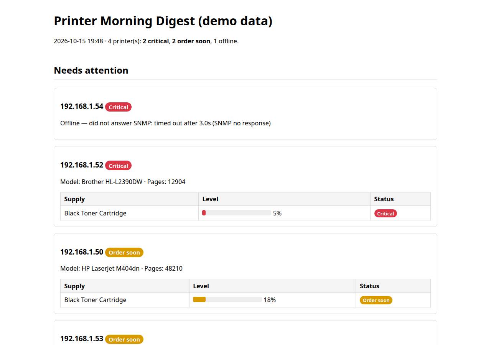

# printer-auditor

Find every network printer, poll it over SNMP, and generate a fleet report —
models, page counts, and toner levels with low-supply flagging.

Stop discovering dead toner cartridges when a user calls angry. Run this
monthly and reorder before it matters.

**Zero third-party dependencies** — includes a minimal stdlib-only SNMPv2c
client (`snmp.py`), so it runs anywhere Python runs.



*The morning digest on demo data. Live demos: https://cnoteninja.github.io/Portfolio/*

## Quick start

```bash
# Discover printers on the subnet, poll them, build the report
python printer_audit.py --subnet 192.168.1.0/24

# Or skip discovery and poll known hosts
python printer_audit.py --hosts 192.168.1.50 192.168.1.51 --community private

# Predict days-until-empty from accumulated history, with part numbers
python predict_toner.py

# One HTML digest for the morning coffee (audit + predictions + growers)
python morning_digest.py --hosts 192.168.1.50 192.168.1.51

# See it work in ~30 seconds with no printers and no network
python morning_digest.py --demo

# Readiness check: Python, config, demo data, printer reachability
python check_setup.py
```

Open `printers.html` (or `digest.html` for the morning summary).

## Morning digest (`morning_digest.py`)

One file, one glance. Runs a fresh audit, pulls the toner predictions, and
writes `digest.html` with four sections:

1. **Printers needing attention** — everything not OK, offline printers first,
   with per-cartridge status badges
2. **Offline printers** — hosts that didn't answer SNMP
3. **Toner reorder list** — cartridges at Critical / Order soon, with part
   numbers from `cartridges.json`
4. **Top page-count growers** — biggest page-count increases over the last
   30 days (from `data/page_history.csv`, built up automatically by each audit)

```bash
python morning_digest.py --subnet 192.168.1.0/24
python morning_digest.py --hosts 192.168.1.50 192.168.1.51 --community private
python morning_digest.py --demo --out sample-digest.html
```

### Emailing the digest

Pass `--mailto` and the digest is sent as an HTML email via `smtplib`:

```bash
python morning_digest.py --hosts 192.168.1.50 --mailto you@example.com
python morning_digest.py --demo --mailto you@example.com   # tests your SMTP setup, no printers needed
```

Email settings come from the `smtp` section of `config.json` (see
`config.example.json`; copy it to `config.json`). **Credentials are never
hardcoded.** Username and password may use `${ENV_VAR}` expansion, and any
missing value falls back to environment variables:

| Setting | config.json | env fallback |
|---|---|---|
| SMTP host | `smtp.host` | `SMTP_HOST` |
| SMTP port | `smtp.port` | `SMTP_PORT` (default 587) |
| username | `smtp.username` | `SMTP_USERNAME` |
| password | `smtp.password` | `SMTP_PASSWORD` |
| From address | `smtp.from` | `SMTP_FROM` |
| default recipients | `smtp.to` (list) | — |

```json
{
  "smtp": {
    "host": "smtp.gmail.com",
    "port": 587,
    "use_tls": true,
    "username": "${SMTP_USERNAME}",
    "password": "${SMTP_PASSWORD}",
    "from": "${SMTP_FROM}",
    "to": ["you@example.com"]
  }
}
```

With no `--mailto` addresses, the digest goes to `smtp.to`. `config.json`
is git-ignored, so credentials never end up in the repo.

## Status labels (`status.py`)

Every printer and cartridge maps to one plain-English label — `OK`,
`Order soon`, or `Critical`. The mapping lives in **one module**
(`status.py`) so the audit report, the prediction script, and the digest
all use the same thresholds:

| Label | Meaning | Thresholds |
|---|---|---|
| **Critical** | reorder / fix now | level ≤ **10%** · empty within **3 days** · printer offline |
| **Order soon** | stock the replacement | level ≤ **25%** · empty within **14 days** |
| **OK** | nothing to do | everything else |

Labels are color-coded in terminal output (green / yellow / red) and appear
as badges in every HTML report. A cartridge is "unknown"/"ok"/missing only
when the printer gave no usable reading — that maps to OK, never an alarm.

## Demo mode

No printers? No network? See the full output in ~30 seconds:

```bash
python morning_digest.py --demo
```

`--demo` reads the bundled sample data (`demo/sample_printers.json` +
`demo/sample_toner_history.csv` — kept in `demo/`, separate from the
git-ignored `data/` dir that holds your real fleet's history) and produces
a complete sample `digest.html`: a critical toner, an order-soon cartridge
flagged by its 12-day depletion projection, and an offline printer.

## Setup checker (`check_setup.py`)

Plain-English PASS / FAIL / SKIP lines, never a traceback:

```bash
python check_setup.py
```

```
PASS  Python 3.12.3 (>= 3.8)
SKIP  no config.json — email disabled (copy config.example.json to config.json to enable it)
PASS  demo bundle OK — 4 sample printers, 28 history rows (try: python morning_digest.py --demo)
SKIP  no hosts in config.json — run python printer_audit.py --subnet 192.168.1.0/24 to discover
```

It checks the Python version, validates `config.json` if one exists (valid
JSON, `smtp.host` present when an `smtp` section is configured), verifies
the demo bundle parses, and tries a short-timeout TCP connection to port
9100 on each host listed under `"hosts"` in `config.json` — unreachable
printers are reported as FAIL lines, not crashes. Exits 0 when nothing
failed, 1 otherwise.

## Toner history + depletion prediction

Every audit run appends one row per cartridge per printer to
`data/toner_history.csv` (timestamp, host, model, color, level %). That file
is **local-only** — `data/` is git-ignored so your fleet's supply data never
leaves the machine. Run the audit on a schedule (weekly is plenty) and the
history gets more accurate.

`predict_toner.py` reads the history, fits a simple linear depletion rate
(level % vs time) per cartridge, and prints a reorder list:

```bash
python predict_toner.py                 # flag anything emptying within 14 days
python predict_toner.py --threshold 30  # ...within 30 days
python predict_toner.py --csv data/toner_history.csv --catalog cartridges.json
```

Example output:

```
loaded 3 model(s) from cartridges.json
toner reorder list — 4 cartridge(s) tracked

Reorder now (<= 10% remaining):
  192.168.1.52     Brother HL-L2390DW              black      8%  part: TN-760
  192.168.1.53     Some Mystery Printer 9000       black      9%  part: part number unknown

Projected empty within 14 days:
  192.168.1.50     HP LaserJet M404dn              black     20%  ~10.0 days left  part: CF258A
```

Notes:

- A cartridge needs **at least 2 history points** before a prediction is made.
- Flat or rising levels (fresh cartridge installed) are reported as not
  depleting — no false alarms.
- Part numbers come from `cartridges.json`; models not listed show
  `part number unknown` instead of guessing.

## Cartridge catalog (`cartridges.json`)

Maps printer model → cartridge color → part number, so the reorder list tells
you exactly what to buy:

```json
{
  "HP LaserJet M404dn": {
    "black": "CF258A"
  },
  "HP Color LaserJet Pro MFP M479fdw": {
    "black": "CF410A",
    "cyan": "CF411A",
    "magenta": "CF413A",
    "yellow": "CF412A"
  }
}
```

- **Model names must match the model strings printers report via SNMP**
  (check the model column in `printers.csv` or the HTML report — `predict_toner.py`
  does exact matching).
- Colors are lowercase: `black`, `cyan`, `magenta`, `yellow`. Add your own
  models and colors freely — unknown models/colors fall back to
  `part number unknown`.
- The file is committed to the repo as an editable template (the `.gitignore`
  carves out an exception for it), so edit it in place.

## How it works

1. **Discovery** — scans the subnet for port 9100 (JetDirect), which means
   "printer" with very few false positives
2. **SNMP poll** — pulls model, serial, page count (`prtMarkerLifeCount`),
   and every supply's description/level/capacity from the Printer MIB
3. **History** — appends per-cartridge levels to `data/toner_history.csv`
   and page counts to `data/page_history.csv` (both local-only, git-ignored)
4. **Report** — HTML fleet cards with toner bars and status badges;
   supplies ≤10% counted up top
5. **Prediction** — `predict_toner.py` fits a depletion rate per cartridge
   from history and prints a reorder list with part numbers
6. **Digest** — `morning_digest.py` rolls the audit, predictions, and
   page-count growers into one `digest.html`, optionally emailed

## Files

| File | Purpose |
|---|---|
| `printer_audit.py` | Discovery + polling + HTML report + history logging |
| `predict_toner.py` | Days-until-empty prediction + reorder list |
| `morning_digest.py` | Morning coffee digest: audit + predictions + growers → `digest.html`, optional `--mailto` |
| `check_setup.py` | Readiness check: Python, config, demo data, printer reachability |
| `status.py` | One place for OK / Order soon / Critical labels + thresholds |
| `cartridges.json` | Model → {color: part number} catalog (edit me) |
| `config.example.json` | Template for `config.json` (SMTP + hosts; real file is git-ignored) |
| `snmp.py` | Minimal SNMPv2c GET client (stdlib only) |
| `demo/` | Bundled sample data for `--demo` (tracked; separate from git-ignored `data/`) |
| `data/toner_history.csv` | Per-run cartridge levels (local-only, git-ignored) |
| `data/page_history.csv` | Per-run page counts (local-only, git-ignored) |
| `printers.csv` / `printers.html` / `digest.html` | Generated output (git-ignored) |

## Requirements

- Python 3.8+, no pip packages
- Printers must allow SNMP (community string, default `public`)
- Windows / Linux / macOS

## License

MIT — use it on client jobs.
